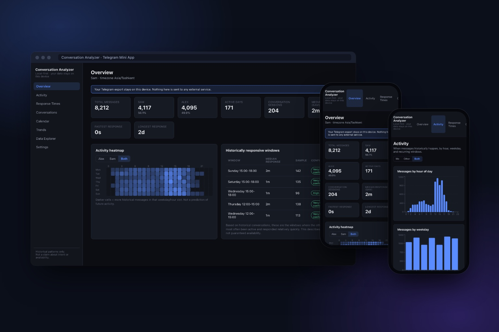
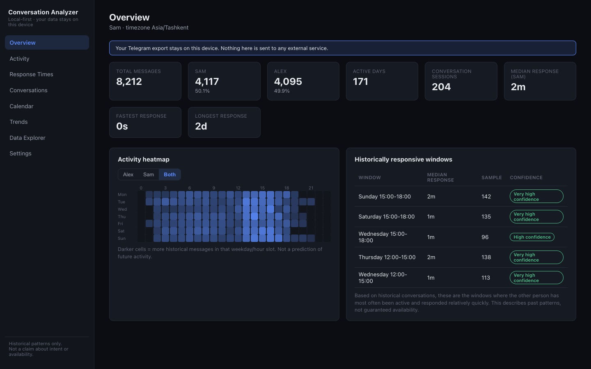
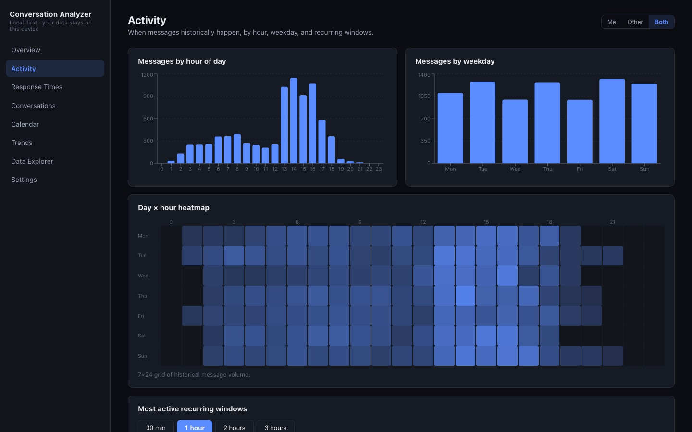
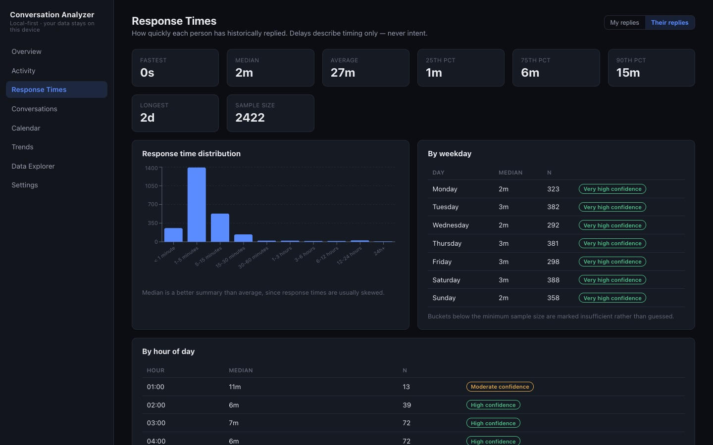
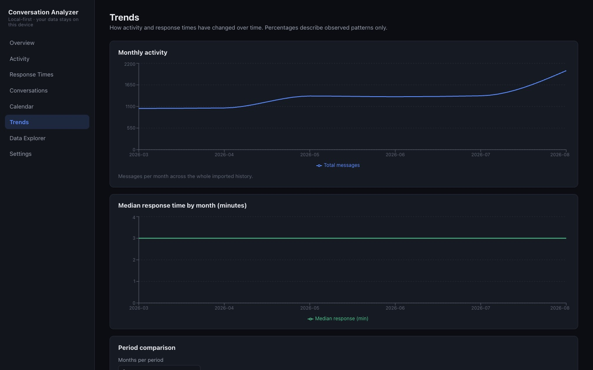
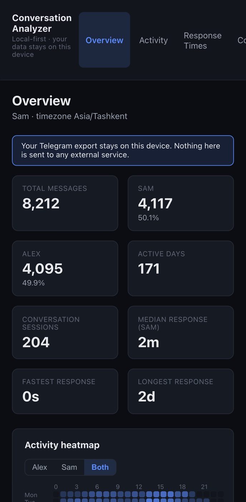
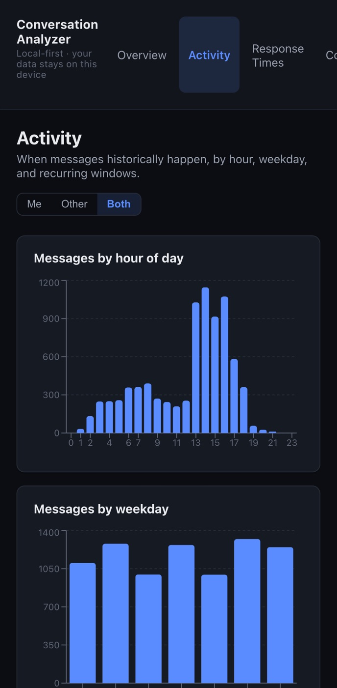

# ChatPulse: Telegram Conversation Analyzer 📊

**See the rhythm of a conversation: when each person is active, how fast they usually reply, and how that changes over time. Built privacy-first, so message text never leaves your control.**

Runs **locally** (CLI + web dashboard) or as a **Telegram bot with a Mini App dashboard**, where each user gets their own isolated database.



<sub>All screenshots use a synthetic conversation between two fictional people. No real chat data.</sub>

## Features

- **Import a Telegram export** (`result.json`), including nested rich-text messages, via the dashboard, the CLI, or by sending the file to the bot.
- **Activity**: messages by hour and weekday, a 7×24 heatmap, and the most active recurring time windows.
- **Response times**: fastest, median, percentiles and longest reply, broken down by weekday and hour. Every number carries a **confidence label based on sample size**, and buckets with too little data say so instead of guessing.
- **Conversations**: automatic session detection (configurable gap) and grouping of message bursts.
- **Trends**: monthly activity, median reply time over time, and period-to-period comparisons.
- **Telegram bot** in Uzbek and English: `/overview`, `/fastest`, `/slowest`, `/sessions`, `/windows`, and `/ask`, which answers questions from the computed statistics only, with no LLM involved.
- **Telegram Mini App**: the full dashboard opens inside Telegram, with no separate login.

## Screenshots

| Overview | Activity |
|---|---|
|  |  |
| **Response times** | **Trends** |
|  |  |

<p align="center">
  
  &nbsp;
  
</p>


## What this is (and isn't)

This tool reports **observed communication patterns** — message timing,
response delays, activity windows. It deliberately avoids claiming to know
whether someone is free, interested, or intentionally not replying. You'll
see language like *"historically active"*, *"historically responsive"*, and
*"longest observed response delay"* throughout — never *"she was ignoring
you"* or *"she is free at this time"*. The system cannot know intent, and
doesn't pretend to.


## Privacy

- Your Telegram export and the SQLite database live under `data/`, which is
  gitignored and never leaves your machine.
- No analytics, no telemetry, no cloud database, no automatic upload.
- The `/ask` bot command answers questions with **keyword matching against
  already-computed statistics** — not an LLM call, and never sees the raw
  conversation. If you later want to send an external LLM anything, it
  should only ever be the aggregated numbers, and only if you explicitly
  wire that up yourself.
- The public GitHub repo never contains anyone's Telegram user ID, name, or
  message content. You configure your own participants locally (Settings
  page or CLI), and that configuration stays in your local database.


## Architecture

```
Telegram export (JSON) ──► Python importer ──► normalized database (SQLite locally / Postgres in the cloud)
                                                        │
                                       analysis engine: activity · response times · sessions · trends
                                                        │
                                                   FastAPI REST API
                                                   │            │
                                       React + Vite dashboard   Telegram bot (+ Mini App)
```

## Engineering highlights

- **Multi-tenant with database-level isolation.** In cloud mode every Telegram user gets their own
  Postgres schema (`tenant_<telegram_user_id>`) on a shared Neon database, so one user can never
  read another's data, even through a bug in application code. Locally it uses one SQLite file per tenant.
- **Telegram-native auth.** The Mini App verifies Telegram's signed `initData` server-side with
  HMAC-SHA256 (`backend/app/auth.py`). The webhook checks Telegram's secret-token header before
  processing anything.
- **Production hardening.** I diagnosed and fixed real outages in production: bot handlers blocking the
  shared event loop, duplicate processing when the webhook acknowledged too late, a lock deadlock
  (fixed with bounded Postgres timeouts and a real asyncio timeout), and a connection pooler rejecting
  a startup parameter.
- **Correct time handling.** All analysis runs in the conversation's configured timezone, not UTC, and
  there's a regression test that guards it.
- **Honest statistics.** Medians over averages, explicit confidence labels and neutral wording
  ("historically responsive"), because the data shows timing, not intent.
- **About 90 automated tests** (pytest) across the parser, analyzers, timezones, multi-tenant Postgres,
  migrations, the bot, i18n and a full API integration pass, all on synthetic fixtures.
- **Ships as one Docker image**: the API serves the built React app, with Render + Neon free-tier deploy
  notes in [DEPLOY.md](DEPLOY.md).

## Tech

**Python** · **FastAPI** · **SQLAlchemy** · **Pandas** · **PostgreSQL (Neon)** / **SQLite** · **React** · **Vite** ·
**Telegram Bot API** + **Mini Apps** · **pytest** · **Docker** · GitHub Actions

## Requirements

- Python 3.11+
- Node.js 18+
- A Telegram Desktop export (Settings → Advanced → Export chat history → JSON)

## Setup

### 1. Backend

```bash
cd backend
python3 -m venv .venv
source .venv/bin/activate         # Windows: .venv\Scripts\activate
pip install -r requirements.txt
cp .env.example .env              # optional, defaults already work
```

Run the API:

```bash
python -m analyzer server --reload
```

The API is now at `http://127.0.0.1:8000` (docs at `/docs`).

### 2. Frontend

```bash
cd frontend
npm install
npm run dev
```

Open `http://localhost:5173`. The dev server proxies `/api` to the backend.

### 3. Import your conversation

Either through the **Settings** page in the dashboard (recommended — it
imports the file, lists the actual senders found in it, and lets you click
"Use as Me" / "Use as Other" instead of typing an id), or via the CLI:

```bash
cd backend
source .venv/bin/activate

# 1. Import first, without guessing ids
python -m analyzer import /path/to/result.json --timezone Asia/Tashkent

# 2. See the EXACT sender ids Telegram used in your export
python -m analyzer participants
#   user100000001   Alice    4102 messages
#   user2000000002  Bob  4319 messages

# 3. Configure with those exact ids, then analyze
python -m analyzer configure --me-id user100000001 --me-name "Me" \
  --other-id user2000000002 --other-name "Bob"
python -m analyzer analyze
python -m analyzer stats
```

> **Important:** Telegram Desktop exports store sender ids in a *prefixed*
> form, e.g. `user100000001` — not the bare numeric id you'd see in Telegram
> settings. Always get the exact string from `python -m analyzer participants`
> (or the Settings page's sender list) rather than typing it from memory. If
> the configured ids don't match anything, `analyze` now fails with a clear
> error listing the real senders found, instead of silently reporting all
> zeros.

Re-run `python -m analyzer analyze` (or the "Re-run analysis" button in
Settings) any time you change participants, timezone, the message-burst
grouping window, or the session-gap threshold.

### 4. Optional: Telegram bot

```bash
cd backend
source .venv/bin/activate
pip install -r bot/requirements.txt
echo "TELEGRAM_BOT_TOKEN=<token from @BotFather>" >> .env
python -m bot.main
```

Message your bot `/start`, then send it your `result.json` export directly
as a file — no need to run `analyzer import` yourself. The bot detects
which of the two senders is you (by matching your real Telegram user id
against the export), configures participants, and runs the analysis
automatically. Commands: `/overview`, `/dashboard`, `/fastest`, `/slowest`,
`/sessions`, `/windows`, `/ask <question>`.

### 5. Cloud mode: no local setup for your users at all

The same codebase can run as a hosted, multi-tenant service — each
Telegram user gets their own isolated database (a dedicated Postgres
schema when using a free host with no persistent disk, or a SQLite file
per tenant on a host that has one), imports by sending a file straight to
the bot, and views the full dashboard as a **Telegram Mini App** (opened
via a bot button, running right inside Telegram, no separate login). See
**[DEPLOY.md](DEPLOY.md)** for the full setup (Render + Neon, both free,
no credit card). Local development is completely unaffected — cloud mode
only activates when `MULTI_TENANT=true` is set.

## CLI reference

```bash
python -m analyzer import <file.json> [--me-id ID --me-name NAME --other-id ID --other-name NAME --timezone TZ]
python -m analyzer participants
python -m analyzer configure [--me-id ID --other-id ID --grouping-window N --session-gap N --min-sample N ...]
python -m analyzer analyze
python -m analyzer stats
python -m analyzer server [--host --port --reload]
```

## Testing

```bash
cd backend
source .venv/bin/activate
python -m pytest
```

The suite covers Telegram JSON parsing (including nested rich-text
entities), timezone conversion, message-burst grouping, response-time
calculation, session detection, weekday/hourly statistics, insufficient
sample-size handling, and a full API integration pass — all against
synthetic fixtures, never real conversation data.

```bash
cd frontend
npx eslint src
npm run build
```

## Methodology notes

- **Message-burst grouping**: consecutive messages from the same person
  within a configurable window (default 5 minutes) count as one "burst"
  before response time is computed, so a 3-message stream followed by one
  reply is one response event, not three.
- **Sessions**: a new conversation session starts after a configurable
  inactivity gap (default 6 hours).
- **Confidence labels**: any ranked window (best response time, most active
  slot, etc.) is gated by a minimum sample size (default 10 observations).
  Below that, the UI shows "Insufficient data" rather than a misleadingly
  precise number.
- **"Historically Responsive Windows"** combines message volume and
  response speed into one ranking, always framed as a historical pattern,
  never as a guarantee of availability.

## Development phases

1. Telegram parser + database
2. Activity analysis (hour/weekday/heatmap/top windows)
3. Response-time analysis (bursts, percentiles, distribution, no-response)
4. Conversation sessions
5. FastAPI
6. React + Vite dashboard
7. Telegram bot
8. Tests + polish

All phases are implemented and tested.

## Built by

**[Abdurashid Fattokhov](https://afa06.github.io/My_Portfolio/)**: design, backend, frontend, bot and deployment.
